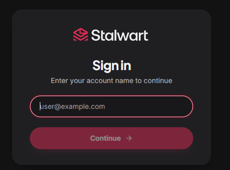
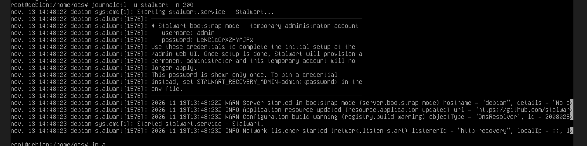
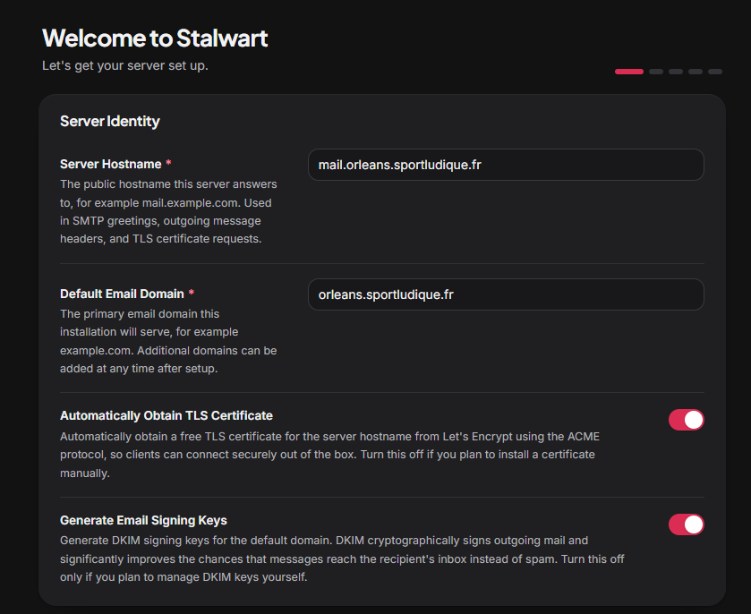
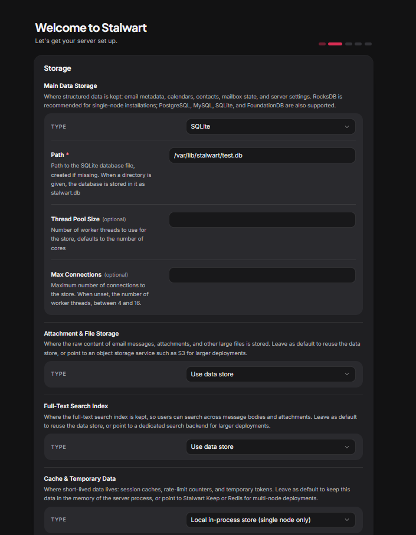
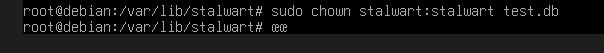
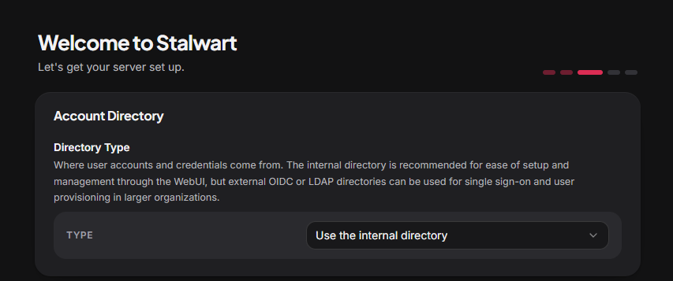
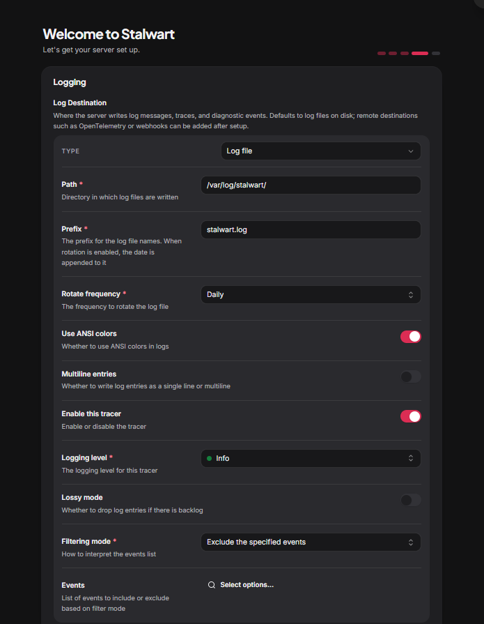
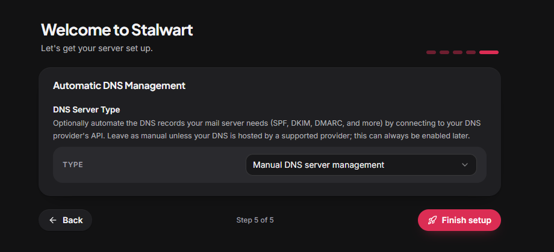
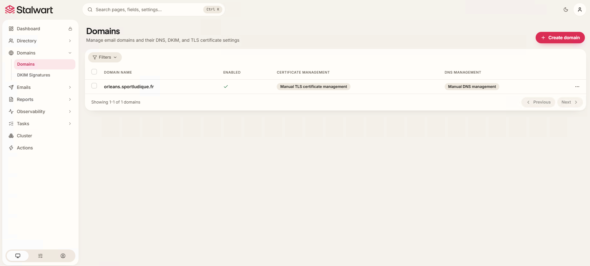

# Stalwart

## Préalable

Tout d'abord on va préparer la zone DNS du domaine.On va ajouter un enregistrement A pour le serveur et un enregistrement MX pointant vers ce nom :

```
@       IN MX 10 mail.orleans.sportludique.fr.
mail    IN A     <IP_Serveur_Mail>
```

Et on vérifie que l'enregistrement est bien pris en compte

```
dig mail.ville.sportludique.fr A +short
dig ville.sportludique.fr MX +short
```

## Installation Stalwart

Stalwart ne s'installe pas avec la commande ***sudo apt install***. Alors on l'installe avec un script fournit par Stalwart et sera enregistré dans un fichier nommé ***install.sh***.

```
curl --proto '=https' --tlsv1.2 -sSf https://get.stalw.art/install.sh -o install.sh
```

Ensuite on peut exécuter le fichier

```
sudo sh install.sh
```

On verifie l'installation de Stalwart :

```
sudo systemctl status stalwart
```

Et on regarde les ports ouverts :

```
sudo ss -lntp
```

## Configuration Stalwart

Une fois Stalwart installé, la configuration ce fait via une interface web accessible avec l'ip de la machine et vous devez arriver sur cette page :



Vous retrouverez l'identifiant et le mot de passe pour la première connexion dans les logs de stalwart 
**!Mot de passe de l'user admin à modifier!**

```
journalctl -u stalwart -n 200
```


Une fois connecté en **admin** vous pouvez commencer la configuration.

## Server Identity

La première étape est de :
- mettre le nom du serveur (mail.orleans.sportludique.fr)

- mettre le nom de domaine (orleans.sportludique.fr)



## Stockage

La seconde étape est de choisir un type de stockage. Dans notre cas on va utiliser SQLite.

SQLite va chercher un fichier où il peut écrire dedans, pour cela on va créer un fichier dans le répertoire /var/lib/stalwart/.



Lors de l'installation de Stalwart, un user et un groupe se nommant **Stalwart**. Il faut donc attribuer la propriété a l'user et au groupe Stalwart au chemin /var/lib/stalwart/"nom".db



Sinon vous aurez ce message d'erreur :


## Account Directory

Par défaut


## Logs

Cette étape sert à choisir le type de logs que vous souhaitez avoir. Dans notre cas on veut un fichier de logs qui sera nommé **stalwart.log** dans le chemin ***/var/log/stalwart/*** avec une frequence journalier.



## DNS

Etant donné que nous avons notre propre serveur DNS on choisit un management manuel.



Après la configuration faite, redemarrez le service :
```
sudo systemctl restart stalwart
```

## Administration

Maintenant que Stalwart est configuré on peut commencer a l'administrer et le parametrer a nos besoins.

Si votre DNS a bien été configuré avec les bons enregistrements, (voir [Préalable](#préalable)) vous pourrez avoir accès a l'interface web en https, dans notre cas : 
```
https://mail.orleans.sportludique.fr
```

Une fois connecté, vérifiez le domaine dans :
**Management > Domains > Domains** 
 
 et verifiez que c'est bien **ENABLED**

 


 ## Ouverture des ports

 Dans `Settings › Network › Listeners`, créer (ou modifier) deux écouteurs sans chiffrement :

| Champ | Soumission SMTP | Consultation IMAP |
| :--- | :--- | :--- |
| **Listener Id** | `submission` | `imap` |
| **Protocol** | `SMTP (smtp)` | `IMAP (imap)` |
| **Bind addresses** | `ipv4-service:587` | `ipv4-service:143` |
| **Enable TLS (`useTls`)** | Désactivé | Désactivé |
| **Implicit TLS (`implicitTls`)** | Désactivé | Désactivé |